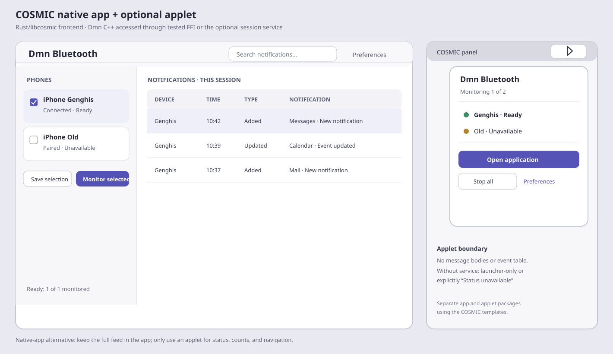

# Dmn Bluetooth Native COSMIC Application and Applet Specification

**Status:** Optional alternative/companion proposal; not implemented.

This document covers two related but separately packaged COSMIC integrations:
a native `libcosmic` application for the full workflow and an optional COSMIC
panel applet for concise status/quick access. Neither is required for the
recommended standalone GTK app.



## 1. Platform and architecture decision

COSMIC applications and applets use the Rust-based `libcosmic` toolkit and
COSMIC templates. This gives a COSMIC-coherent appearance and a supported
COSMIC applet mechanism, but the existing ANCS/BlueZ monitor is C++.

Choose and test one integration boundary before implementing UI:

1. **Rust-to-C++ FFI:** expose a narrow, exception-safe C ABI (or a maintained
   CXX bridge) around Dmn monitor/controller values. Own every opaque handle
   explicitly, translate typed errors, and guarantee callbacks are stopped
   before Rust state is freed. Do not expose C++ STL types or exceptions over
   the ABI. This can keep a standalone native app independent of a daemon but
   increases cross-language build/test complexity.
2. **User-session D-Bus service:** the Rust applet/app uses a versioned,
   typed D-Bus protocol; a C++ service owns Dmn monitors. This is the preferred
   boundary if both app and applet need the same live monitor or monitoring
   must outlive a window. It introduces service lifecycle, authorization, and
   packaging obligations in
   [`dmn-bluetooth-session-service-spec.md`](dmn-bluetooth-session-service-spec.md).

Do not duplicate BlueZ/GATT/ANCS in Rust, do not let an applet independently
connect to BlueZ, and do not assume the D-Bus service is mandatory for a
single native app if a tested FFI is selected. The applet needs shared state
through either an explicit FFI-hosted process architecture or the service;
the service is the cleaner multi-frontend design. A panel applet alone is
not suitable for a detailed event archive.

### Toolkit and package layout

Use the official `cosmic-app-template` and `cosmic-applet-template` as
starting points, pin the Rust toolchain and `libcosmic` revision, and keep
application and applet artifacts independently installable. `libcosmic` is
Rust-based and built on iced; do not assume upstream iced examples or
`iced_test` are binary/source-compatible with the exact `libcosmic` revision.
The official template's `just build`, `just run`, and `just check` are useful
build/lint entry points; add deterministic `cargo test` suites for logic.

Suggested layout if both are pursued:

```text
apps/cosmic/
  Cargo.toml                         # workspace; not part of CMake configure
  crates/
    dmn-cosmic-model/                # pure Rust view-state / reducers
    dmn-service-client/              # only if the service boundary is chosen
    dmn-cxx-bridge/                  # only if direct FFI is chosen
  app/
    Cargo.toml
    src/main.rs
    src/app.rs
    src/view/
      device_list.rs
      notification_list.rs
      notification_details.rs
      preferences.rs
  applet/
    Cargo.toml                       # separate installable applet
    src/main.rs
    src/popup.rs
    src/service_client.rs
```

Do not add empty packages before they are needed. The pure model and service
client should be Rust libraries with injected clocks/transports, allowing
`cargo test` without a running COSMIC shell or Dmn C++ runtime. Keep COSMIC
widgets in `view/` and an applet's shell integration in its package.

## 2. Native COSMIC application

### Goals and build/package boundary

The app provides the same domain workflow as the GTK specification while
using COSMIC widgets, themes, launcher metadata, and keyboard conventions.
Name it `dmn-bluetooth-cosmic`; do not replace `dmn-bluetooth-cli` or claim
GTK support. Keep it in a separate Rust/Cargo package and build gate so normal
Dmn CMake builds do not require Rust or `libcosmic`. Define supported COSMIC
versions and package using the actual COSMIC app template guidance. The
`libcosmic` project documents `com.system76.CosmicApplication` in metainfo for
COSMIC app identification; applications may be submitted to Flathub.
COSMIC-specific applets use `com.system76.CosmicApplet` and the COSMIC Flatpak
repository rather than treating app and applet as one package. Confirm current
store submission requirements at implementation time.

The first screen is a responsive two-column layout: **Phones** and
**Notifications**, with header search/preferences, explicit Save/Monitor/Stop
actions, newest-first events, and accessible states. Avoid custom shell chrome.
Feature behavior, privacy policy, 1,000-row cap, filters, event details,
ANCS errors, and test gates match the shared [GTK app spec](dmn-bluetooth-gtk-app-spec.md)
unless this document says otherwise.

### Interaction requirements

- First run explains live-session ANCS behavior and privacy; fetch inventory
  and show paired, connected, and disconnected BlueZ-known devices.
- Checkbox changes are draft state. **Save selection** persists stable
  `(adapter address, device address)` identities; **Monitor selected** is
  disabled until the draft is saved. Launch and selection edits never pair
  or connect.
- **Start** reports inventory, optional discovery, pairing, connection, ANCS
  subscription, and Ready as distinct states. A per-device failure must not
  mislabel another device or implicitly stop it.
- Event list has **Device**, **Received**, **Type/category**, and
  **Notification**; filters cover device, event kind/category, and search.
  Activation shows a detail surface with only received attributes. Empty,
  unavailable, no-results, overflow, and permission-needed states are
  explicit.
- **Stop** ends the ANCS session only. Quit stops monitor and clears
  in-memory content; bonds/links remain. Optional generic desktop alerts and
  hidden-window monitoring follow the GTK spec only if the selected platform
  integration is actually available.
- Persist UI preferences and selected stable identities only. Never persist,
  log, or export ANCS notification text by default.

Use COSMIC standard theme tokens and controls, scalable layouts, keyboard
navigation, screen-reader semantics, visible focus, and textual status in
addition to icons. Do not assume a GNOME panel, shell extension, system tray,
or notification API is present.

### Applet interaction requirements

The applet is a separately installable COSMIC component. Its compact icon
opens a popup with:

- **Dmn Bluetooth** and current service connection state;
- selected phone rows with concise textual states (Ready, Starting, Failed,
  Unavailable);
- an optional generic **N new events** count (user-controlled and off by
  default);
- **Open application**, **Start selected**, **Stop all**, and **Preferences**.

The applet does not display notification titles/bodies, full history, pairing
dialogs, or address-level settings. **Open application** activates
`dmn-bluetooth-cosmic`. Without a service, the applet must either be a
launcher-only control or explicitly show unavailable state; it must not
invent live status. If service connection is lost, disable mutations and
preserve **Open application**.

The wireframe shows both the full window and compact applet popup.

## 3. D-Bus service and alert relationship

COSMIC's documented app/applet toolkit is not a guarantee of GIO
`GNotification` integration or notification-center API parity. If desktop
alerts are required, isolate them behind an adapter, test the notification
service on the target COSMIC release, and keep alert delivery optional and
generic. No frontend may read notification-center history.

If a COSMIC app and applet need to share monitor state, prefer one service
owner rather than multiple independent C++ monitor instances. Define the
service API, version negotiation, caller permissions, event retention,
restart/shutdown, and privacy before applet implementation. The native app
may also use tested C++ FFI instead of a service when it is the sole frontend.

## 4. Test-driven implementation plan

### Native application

1. **Toolchain/template.**
   - Test: verify chosen compiler, template revision, minimum COSMIC release,
     packaging format, and a clean default Dmn CMake build without Cargo.
   - Implement: generate the official application template and pin the
     Rust/libcosmic versions.
   - Verify: template builds, launches, packages, installs, and removes on a
     clean supported Pop!_OS/COSMIC machine; run template `just check`.
2. **Boundary proof.**
   - Test: construct/destroy the C ABI wrapper or fake D-Bus client; validate
     owned event copies, typed errors, callback quiescence, finite operations,
     and (for D-Bus) version negotiation, owner loss, and malformed responses.
   - Implement: only the selected boundary. C ABI functions must catch all
     C++ exceptions and return owned values; no STL object or borrowed string
     may cross into Rust.
   - Verify: Rust contract tests plus C++ boundary tests; ASan/TSan or other
     configured sanitizers where available. Prove no callback after drop.
3. **Pure Rust presentation model.**
   - Test: event/status conversion, optional attributes, Removed events,
     arrival-sequence order across wall-clock changes, filters, 1,000-row
     eviction, and payload-free diagnostics.
   - Implement: `dmn-cosmic-model` as a display-free crate with injected clock
     and synthetic event fixtures.
   - Verify: `cargo test -p dmn-cosmic-model`; run `cargo clippy`/template
     `just check` and inspect test coverage for every state/enum.
4. **Inventory and selection.**
   - Test: paired/connected/unavailable rows, duplicate names across
     adapters, stable identities, draft/save/discard, settings round-trip,
     and no Pair/Connect call on launch or checkbox change.
   - Implement: inventory-facing model, saved preference values, then the
     COSMIC list/actions.
   - Verify: model tests run without shell; view tests with an injected fake
     inventory assert text and control enabled-state. Confirm settings
     contain no ANCS payload.
5. **Monitor lifecycle.**
   - Test: progress ordering, start failure, Retry, stop during start,
     shutdown, per-device error isolation, and cleanup. Document that the
     existing synchronous Dmn stop waits for start and is not cancellation.
   - Implement: controller/client calls without blocking the UI executor;
     make stop-during-start show “stop requested” until actual completion.
   - Verify: deterministic fake boundary test with delayed responses; assert
     app state loop continues and no callback uses a dropped view/controller.
6. **Event feed and accessible view.**
   - Test: filters, sort/arrival sequence, search, detail values, empty and
     no-results states, keyboard navigation, and no payload persistence.
   - Implement: responsive list/table and detail surface using `libcosmic`
     widgets/theme and accessible labels.
   - Verify: unit tests first; use `iced_test::Simulator` only if the pinned
     `libcosmic` version supports it without substituting a different widget
     tree. Otherwise use tested reducer/view-model actions plus shell-session
     smoke tests. Verify all controls with keyboard and screen reader on the
     target COSMIC release.
7. **Desktop packaging and alerts.**
   - Test: launcher activation, optional alert adapter disabled/off by
     default, generic alert text only, notification-service absence, and app
     shutdown.
   - Implement: only integration supported by the selected target COSMIC
     release. Keep passive alert submission behind an adapter and never make
     the notification center the event store.
   - Verify: `just check`, `cargo test --workspace`, and package install/
     removal. Test notification behavior on actual COSMIC; other desktops are
     not inferred to behave the same.
8. **Hardware gate.**
   - Test: retain fake backend coverage for known ANCS failure and recovery
     states.
   - Implement: no protocol work in the GUI; fix only demonstrated adapter/
     presentation bugs.
   - Verify: opt-in real iPhone tests with recorded COSMIC, BlueZ, adapter,
     phone, and iOS versions. Fake-bus success does not prove hardware support.

### COSMIC applet

1. **Applet template.** Build/install official template. Verify enable,
   disable, and remove without affecting the native app or shell.
2. **Popup model.** Test all state mappings, unknown future enum, service
   missing, and count-hidden behavior with a fake service client. Verify
   disconnected state is unavailable and never stale Ready.
3. **Popup UI.** Test keyboard, screen reader, popup open/close, panel
   orientation/size, theme, and zero payload text. Verify interactively on
   the target shell and automate model/control actions where `libcosmic`
   widget simulation supports the pinned version.
4. **Service calls.** Test authorization/error/timeout and ensure applet
   shutdown does not stop service-owned monitoring. Verify with a private
   session-bus test service and fake responses.
5. **Package lifecycle.** Test update/removal and declared COSMIC release
   compatibility using official template `just check`, `cargo test`, and
   package install checks.

## 5. Acceptance criteria

- The native application remains useful without an applet, shell-specific
  component, or notification server.
- The selected FFI or D-Bus boundary has automated ownership, shutdown, and
  error tests; no direct ANCS logic is duplicated in Rust.
- The applet is optional, concise, payload-free, and reports unavailable
  rather than stale status.
- UI and packaging pass on declared COSMIC versions; default Dmn CMake builds
  do not acquire COSMIC dependencies.

## 6. Research references

- System76 [COSMIC apps](https://system76.com/cosmic/apps) and
  [COSMIC UX/applets](https://system76.com/cosmic/ux).
- [`cosmic-app-template`](https://github.com/pop-os/cosmic-app-template) and
  [`cosmic-applet-template`](https://github.com/pop-os/cosmic-applet-template):
  templates recommend `cargo generate` and provide `just` build/check
  workflows.
- [libcosmic book](https://pop-os.github.io/libcosmic-book/): describes
  `libcosmic` as a Rust toolkit based on iced with COSMIC widgets, theming,
  and platform integration; Rust experience is expected.
- [Freedesktop Desktop Notifications](https://specifications.freedesktop.org/notification/latest/):
  alert sender protocol, not an event-history API.
- Related: [GUI overview](dmn-bluetooth-gui-spec.md), [GTK app](dmn-bluetooth-gtk-app-spec.md),
  and [optional session service](dmn-bluetooth-session-service-spec.md).
