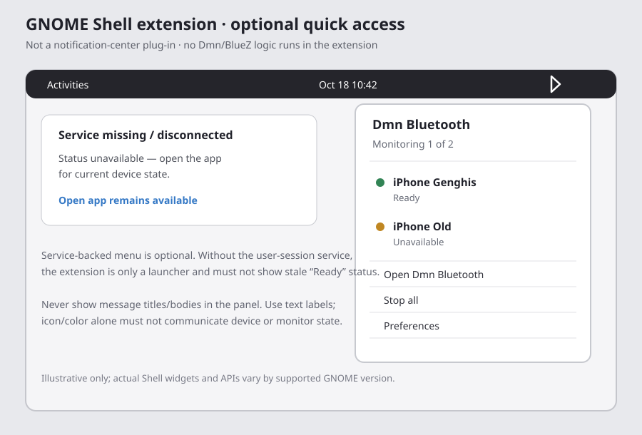

# Dmn Bluetooth GNOME Shell Extension Specification

**Status:** Optional proposed GNOME-only companion; not implemented.

This specification covers a small GNOME Shell panel control. It is not the
recommended full GUI and does not put an ANCS event table inside GNOME's
notification center. The recommended GTK application remains the place to
select devices, inspect event history, search, and manage privacy.

## 1. Purpose and explicit scope

Provide a compact, discoverable GNOME Shell entry point to:

- launch/present the standalone Dmn Bluetooth application;
- optionally show monitor service state, selected device readiness, and a
  redacted count of new events if a separately specified D-Bus service exists;
- expose only concise actions such as **Open app**, **Start selected**,
  **Stop all**, and **Quit service**, subject to service authorization.

The extension does not pair/connect devices, call BlueZ directly, instantiate
`Dmn_AncsBluezMonitor`, read ANCS payloads, persist notification data, or
replace the full app. It does not work on COSMIC or other non-GNOME shells.
Treat this project as **partially automatable**: pure GJS and client logic can
be tested deterministically, but popup behavior and compatibility require a
real GNOME Shell release explicitly named in the support matrix.

**MVP without service:** a menu item that activates the desktop application
and an optional descriptive status that does not pretend to be live.
**Service-backed phase:** display real monitoring status and counts only
after the separate service API and permission rules are implemented.
Never show stale state as live when the service is absent/disconnected.

## 2. GNOME extension limitations and supported surface

GNOME Shell extensions are GJS/JavaScript and CSS loaded into GNOME Shell.
They customize shell-managed UI, such as a panel menu; this is not a stable
cross-desktop widget/plugin ABI for the notification center. Shell APIs and
supported extension versions vary by GNOME release. Do not patch private
notification-center internals or rely on undocumented shell object paths.

The Dmn implementation is C++. The extension must not try to load or re-create
the C++ monitor in GJS. If live state/actions are required, communicate with
the optional user-session service through a versioned D-Bus API. A GNOME
extension is not necessary for GIO desktop alerts.

Package as a separately installable extension with declared UUID, supported
GNOME Shell version metadata, translations where applicable, and an
extension preference page only for extension-specific settings. Never bundle
it into the default/headless Dmn build or make the core GTK app depend on it.
Verify current packaging/install guidance from the actual target GNOME release
before implementation; avoid targeting unsupported shell versions.

### Toolkit and project layout

Use GJS (GNOME's JavaScript runtime with GObject introspection), GNOME Shell's
documented extension entry points, and its extension metadata/packaging
format. Do not add GTK widgets to the Shell panel; use Shell-supported
St/Clutter/Gio APIs for the extension popup and use GTK only in the separate
full application. Start with the GNOME extension template/tooling for the
declared target Shell versions, then verify APIs against that installed
version—the online guide and private Shell APIs may not match every release.

Keep the extension package independent of CMake and Rust:

```text
desktop/gnome-extension/
  metadata.json
  extension.js
  prefs.js                         # only if extension-specific settings exist
  schemas/
  ui/                              # only if supported preferences need UI
  locale/
  tests/
    test-state.js
    test-service-client.js
  meson.build                      # optional packaging/test harness, not Dmn core
```

Keep service protocol/value conversion in pure GJS modules with no Shell
imports so those parts can be tested outside GNOME Shell. Isolate Shell
widgets in `extension.js` and version-specific adapters. Do not try to make
the extension itself a Dmn C++ library target.

## 3. Interaction and wireframe



Keep the collapsed panel indicator minimal and use textual accessible status
in the popup:

- Neutral icon/label: **Dmn Bluetooth**; do not use color alone to indicate
  readiness.
- Service-backed popup: **Monitoring 1 of 2**, device names with **Ready**,
  **Connecting**, **Failed**, or **Unavailable**, a generic “N new events”
  count, then **Open Dmn Bluetooth**, **Stop all**, and **Preferences**.
- If no service is installed: show **Open Dmn Bluetooth** and an explicit
  **Status unavailable — open the app for current state** message. Do not
  claim monitoring is active.
- If the service disconnects while the menu is open, change to unavailable
  status and disable start/stop actions. Never queue a start command for later
  implicit execution.
- **Open Dmn Bluetooth** activates the desktop app through its stable desktop
  application ID, not a guessed executable path. On activation, the app
  presents its window.
- **Stop all** requires confirmation if it affects active sessions. The
  extension only sends an explicit service command; the service validates
  caller identity and current state.
- Do not show title/message previews, phone dates, addresses, or event
  history in the panel. Do not expose notification content in extension
  settings.

## 4. Service boundary and failure behavior

Launcher-only MVP calls the desktop launcher and has no D-Bus monitor
dependency. A future live menu uses the user-session service defined in
[`dmn-bluetooth-session-service-spec.md`](dmn-bluetooth-session-service-spec.md).
The extension may subscribe to read-only status and a payload-free aggregate
count signal; it must not subscribe to `EventReceived` or call
`GetRecentEvents`. All monitor mutations must be explicit method calls with
typed errors and authorization. The service must not rely on extension
presence to own or stop monitoring. This is data minimization, not a
same-user security boundary: the service spec documents that other processes
running as the same user may still be able to request payloads.

On missing service, name-owner loss, incompatible API version, timeout, or
malformed response:

- render a clear unavailable state and retain no invented last-known
  “running” state;
- disable mutating controls;
- keep **Open app** available;
- log only technical error name/version, never ANCS payloads or identifiers
  beyond what is needed for diagnostics; and
- retry only while the menu/application is active with bounded backoff; no
  busy polling.

## 5. Accessibility, privacy, and security

- Build the popup from standard GNOME Shell menu items and actions; do not
  imitate a full application window inside the panel or add custom shell
  chrome.
- Support keyboard navigation, screen-reader names, high-contrast themes,
  text labels, and a visible focus indicator using shell-supported
  accessibility conventions.
- Keep the panel surface concise; avoid competing with standard Bluetooth
  settings or GNOME notifications.
- Use extension preferences for only panel-specific choices such as
  **Show event count** (off by default). A hidden count must not stop
  monitoring.
- Do not add message content to shell UI, extension logs, D-Bus signal
  subscriptions, or extension settings. Do not subscribe to payload-bearing
  event signals even if the extension currently discards their fields.
- Treat every D-Bus response as untrusted input; bound strings/counts and
  validate the service version and enum values.
- No automatic startup of monitoring at login. A service autostart policy, if
  ever proposed, belongs to the service spec and requires explicit consent.

## 6. Test-driven implementation plan

Keep this optional project isolated from the Dmn CMake build. Test the model
and API contract before testing Shell widgets.

1. **Version/tooling spike.** Select exact GNOME Shell versions and confirm
   GJS version, supported extension API, metadata format, packaging command,
   and session test strategy from those releases. Create a template extension.
   **Verify:** package/install/enable/disable/uninstall it in a disposable
   user profile; unsupported versions are rejected or declared unsupported;
   the Shell session remains usable after disable/removal.
2. **Pure state and launcher model.** Test the menu state mapper and launcher
   interface with fake inputs: service absent, unknown enum, empty device set,
   stale owner, duplicate activation, and missing application desktop entry.
   **Verify:** run the pure GJS test suite outside Shell and assert no
   BlueZ/ANCS/D-Bus monitor operation is made in launcher-only mode.
3. **Shell popup.** Test menu-open/close lifecycle, event connections removed
   on disable, accessibility labels, keyboard operation, style/theme changes,
   and accessible state text. **Verify:** enable the extension in a disposable
   GNOME session, query controls through AT-SPI where supported, and verify
   disabling it removes the panel item and all subscriptions.
4. **Optional service client.** Against the service test double, test major
   version mismatch, malformed values, owner loss, finite timeout, status
   sequence gap, unavailable transition, and that the extension neither
   subscribes to payload-bearing events nor calls the event-history method.
   Assert aggregate-count signals contain no notification attributes or
   device addresses.
   **Verify:** run GJS tests against a private session bus; kill/restart the
   fake owner and assert the UI clears live status and disables mutations.
5. **Status and actions.** Test multi-device summary, one failed phone among
   ready peers, count hidden by preference, stop confirmation, authorization
   error, and repeated clicks while an operation is pending. **Verify:** use
   fake D-Bus methods to assert each command is sent exactly once and to the
   versioned API; no ANCS payload enters extension state/logs.
6. **Compatibility/privacy qualification.** Test enable/disable, shell
   restart/session logout, upgrade, accessibility, and log scrub on each
   declared GNOME release. **Verify:** follow each target version's supported
   `gnome-extensions` commands and launcher integration; perform a final
   human review for shell integration and keyboard/screen-reader quality.

## 7. Acceptance criteria

- **GNOME-AC-01:** The full device/event workflow works without the extension.
- **GNOME-AC-02:** Launcher-only mode works without a background service and
  never reports unverified live state.
- **GNOME-AC-03:** Service-backed mode uses only the documented D-Bus
  contract, clears stale status on owner loss, and never reads ANCS payload
  content.
- **GNOME-AC-04:** No direct BlueZ/GATT/ANCS implementation exists in extension code.
- **GNOME-AC-05:** Tested extension versions are explicitly listed;
  unsupported GNOME versions are not silently claimed.
- **GNOME-AC-06:** The popup uses standard Shell menu patterns, is keyboard
  operable, exposes accessible status text, and removes all Shell/service
  subscriptions when disabled.

## 8. Research references

- GNOME [Shell Extensions overview](https://wiki.gnome.org/Projects/GnomeShell/Extensions):
  describes extensions as GJS and CSS customizations loaded by GNOME Shell.
- [GJS Guide](https://gjs.guide/extensions/): extension development entry
  point. Validate exact extension APIs and version metadata against the target
  Shell release before coding; the guide is version-sensitive and its
  compatibility claims must not replace testing on the declared Shell
  versions.
- GNOME Shell source and extension documentation are versioned with Shell;
  treat source inspection as compatibility evidence, not a promise that
  internal APIs are stable.
- [GNOME HIG](https://developer.gnome.org/hig/): design guidance for a concise
  desktop control, not a promise of a stable Shell extension API.
- [GNOME Shell extension tooling](https://wiki.gnome.org/Projects/GnomeShell/Extensions#Tools):
  overview of `gnome-extensions` enable/disable/package tooling; verify
  command behavior on the target distribution.
- [GIO `GApplication`](https://docs.gtk.org/gio/class.Application.html):
  application activation and exported actions for the standalone app.
- Related: [GUI overview](dmn-bluetooth-gui-spec.md),
  [GTK app](dmn-bluetooth-gtk-app-spec.md), and
  [optional session service](dmn-bluetooth-session-service-spec.md).
