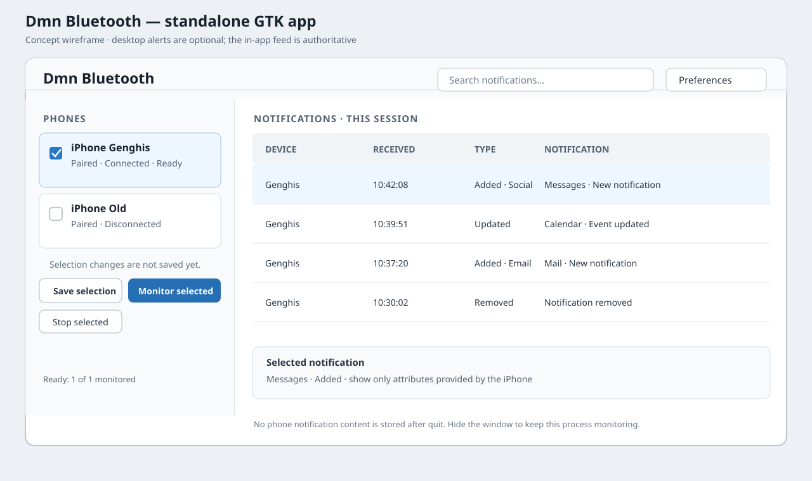

# Dmn Bluetooth GTK Application and Desktop Alerts Specification

**Status:** Implemented feature scope with release qualification outstanding.
The optional GTK application supports BlueZ inventory, explicit discovery,
multiple saved devices, sorting, a draft-based Selected only filter, explicit
per-device connect/disconnect and monitor actions, and a process-local event
feed. Monitoring is enabled only by an explicit per-device user action; that
intent is saved and restored at the next launch. Restored monitors start only
after BlueZ confirms that the saved, paired device is connected. Active
monitors stop when their device disconnects and resume after it reconnects
while the saved monitoring intent remains enabled. Failed starts and
unexpected ANCS Failed/Stopped events are cleaned up and retried with jittered
exponential backoff, starting at about 5 seconds and capped at about 60
seconds; intent is preserved until the user stops monitoring. The GTK
frontend delegates platform-independent lifecycle decisions and retry
scheduling to the `dmn-bluetooth-gui-core` controller.
The live event feed supports composed device, event-kind, category, and
case-insensitive text filters, row details, clearing, stable arrival ordering,
and bounded retention. Generic desktop alerts are implemented as an opt-in
feature. Remaining work is supported-desktop notification and release
qualification. Earlier preferences, close/hidden-window, and expanded
failure/recovery proposals are out of scope. Concurrent multi-device
operation, supported GNOME/COSMIC notification presentation, and real-device
behavior still require qualification.

This document records code-derived current behavior, alert requirements, and
the remaining release-qualification gates. The application owns a live
in-process event feed and submits optional generic alerts through GIO; alerts
are not a durable feed.

## 0. Current implementation

This table records behavior verified in the current implementation.

| Capability | Current implementation |
| --- | --- |
| Optional GTK build and desktop application | Implemented under `ENABLE_APP_BLUETOOTH_GTK`; GTK 4 and libadwaita are optional dependencies. |
| BlueZ inventory and explicit discovery | Implemented with worker-thread BlueZ requests, powered-adapter selection, a finite scan, and explicit scan stop. |
| Saved device selection | Implemented with stable adapter/device addresses, multiple draft/save/discard entries, and unavailable saved devices. |
| Device inventory view | Implemented with Name/Status sorting, a Selected only filter over the current draft selection (its on/off preference is restored across launches), separate paired/connected/monitor states, and per-row Connect/Disconnect and Start/Stop monitoring actions. |
| Adjustable device pane | The window opens maximized. Its draggable GTK divider defaults to an even 50/50 split; user-adjusted pane proportion is saved in GSettings and restored independently of window size. Existing saved absolute pane positions are migrated to a proportion on first launch after the update. |
| Connect/disconnect actions | Implemented per saved device. Unpaired devices must be paired in Bluetooth Settings. A disconnected device offers **Connect**; during a pending connection it changes to enabled **Disconnect**. A connected device offers enabled **Disconnect** regardless of ANCS monitor state or monitor transitions; manual disconnect stops monitoring first and clears its saved monitoring intent. During a queued or running disconnect, the row immediately shows **Connect** and allows a reconnect request to run after disconnect completes. |
| ANCS monitor lifecycle | Implemented per saved, paired, already-connected device with progress and explicit start/stop. **Start monitoring** is available only after BlueZ confirms Connected. The monitoring action remains available during monitor transitions and follows saved user intent rather than transient ANCS state. Starting changes the action to **Stop monitoring** immediately; activating it clears saved intent and cooperatively cancels startup, cleaning up subscriptions created by an in-flight ANCS setup. Stopping changes it back to **Start monitoring**. Disconnecting also stops monitoring and presents **Start monitoring** while disconnected. Monitor start never pairs or establishes the initial link; like the CLI, it asks BlueZ to connect any remaining auto-connectable profiles before ANCS startup. |
| Remembered monitoring intent | Implemented in GSettings using stable adapter/device addresses. An explicit Start monitoring choice is restored on launch; startup waits for a saved, paired device to be connected. Failed starts and unexpected ANCS **Failed**/**Stopped** states retain intent and retry with jittered exponential backoff (about 5 seconds initially, capped at about 60 seconds) while the device remains connected. Unexpectedly stopped sessions are cleaned up before retry. The retry policy and lifecycle decisions are implemented in the GTK-independent GUI core. Stop monitoring and an explicit user Disconnect clear the intent. An external disconnect or app exit stops the live monitor but preserves the intent. |
| Adaptive layout | Implemented as a two-pane window at wide sizes and a device-list/device-detail navigation flow below the libadwaita breakpoint. The narrow layout stacks scan and selection controls. |
| In-session event feed | Implemented using `GListStore`, `GtkFilterListModel`, `GtkSortListModel`, and `GtkColumnView`. Composable filters cover the viewed device or all devices, event kind, category, and Unicode case-insensitive text search. Rows show device, host receipt time, kind/category, and an event preview; row activation opens available details, including phone-provided date when present. Hovering notification text shows its full value wrapped within the feed-pane width. Arrival sequence—not wall-clock time—orders events newest-first. The process-local store retains at most 1,000 events and announces evictions. Clear notifications removes the in-memory feed; Clear filters restores defaults. Removed events show no stale attributes. Notification text remains selectable/copyable. |
| Optional desktop alerts | Implemented through GIO `GNotification`, controlled by an app-menu toggle and disabled by default. New ANCS notification-added events submit a generic alert; titles, bodies, device names, and addresses are excluded. Alerts aggregate per device using replacement IDs and are withdrawn on feed clear, monitor stop, preference disable, or quit. The installed desktop entry declares D-Bus activation and GNOME notification metadata. Submission is best-effort; popup behavior has not been qualified on each supported GNOME/COSMIC release. |
| Desktop metadata and icon | Implemented with an AppStream `.metainfo.xml`, a lowercase desktop/application ID, a full-color Dmn mark (Bluetooth rune inside a D-shaped first letter, followed by `mn`) installed as both 128×128 PNG and scalable SVG hicolor icons, and a matching symbolic Bluetooth icon. The previous GSettings schema ID is retained to preserve saved preferences. |
| Preferences, close confirmation, and keep-monitoring-on-close | Out of scope. Alert preference is in the app menu; quitting stops monitors after cleanup. |

The current GTK window has a **Devices** inventory/sidebar and a
**Notifications** pane with per-device status and the live event feed. Checking
a device changes its draft selection but does not navigate away from the
inventory; activating its name opens the detail/feed pane. Event filters and
the detail view are part of the live feed. Generic desktop alerts are available
through the app-menu toggle. Preferences and hidden-window monitoring are
explicitly out of scope. Simultaneous monitors have not yet been
hardware-qualified.

## 1. Goals, non-goals, and build boundary

### Goals

- Let a user inspect BlueZ-known devices, explicitly choose monitoring
  targets within the qualified concurrency limit, save that choice, and
  start/stop each selected phone.
- Display per-device setup/readiness/errors and a searchable, filterable,
  newest-first in-session ANCS event list.
- Keep the UI responsive during device discovery, pairing, connection, GATT,
  startup, and stop.
- Optionally submit a generic desktop alert when an ANCS event arrives while
  the app process and monitor remain running.
- Use an ordinary desktop launcher entry; do not require a tray, extension,
  applet, or background service for the first release.

### Non-goals

- Reading, importing, or mirroring the GNOME/COSMIC notification-center
  history.
- Pairing, connecting, or monitoring every BlueZ-connected device on launch;
  automatic pairing or initial connection; or automatic disconnection/unpairing
  on monitor stop.
- Continuing monitoring after the process exits, logout, or reboot.
- Sending notification bodies to desktop alerts by default.
- Claiming that ANCS provides complete iPhone notification history.

### Build integration

The separate `ENABLE_APP_BLUETOOTH_GTK` option defaults to `OFF`; the existing
`ENABLE_APP_BLUETOOTH` builds
`dmn-bluetooth-cli` and must remain unchanged. Enabling the GTK option must
enable the required ANCS, BlueZ, and D-Bus library layers using the project's
existing dependency pattern, but must not implicitly enable the CLI app
option or build the CLI unless the user separately requests it. When enabled,
require GTK 4, libadwaita, and GIO development/runtime dependencies. This
specification deliberately targets the GNOME HIG baseline: the current GNOME
HIG describes GTK 4 together with libadwaita as the GNOME platform for
application design. Keep the dependency optional and isolated to this target.
If a required system dependency is missing, CMake must fail at configure time
with its name and installation guidance. Do not let GTK discovery affect a
default/headless build. Name the executable `dmn-bluetooth-gtk`; do not rename
or replace the CLI target. Confirm Linux platform gating and document whether
the GTK frontend requires the same supported-platform policy as the BlueZ
backend.

### Build and install into GNOME or COSMIC

The GTK app is a normal XDG desktop application, not a GNOME Shell extension
or COSMIC-native package. CMake installs the executable, a desktop entry, the
D-Bus activation service, AppStream metadata, full-color 128×128 PNG and
scalable SVG icons plus a symbolic hicolor icon, and updates the hicolor icon
cache when `gtk4-update-icon-cache` is available. It also installs a private
compiled GSettings schema. The desktop entry's `Exec` and `TryExec`, the D-Bus
service, and the installed schema lookup are generated
from `CMAKE_INSTALL_PREFIX`; configure with the final prefix before building.
Do not configure for one prefix and then override it with `cmake --install
--prefix`, because those generated absolute paths would still point to the
configured prefix.

On Pop!_OS, a user-local installation can be built and installed without
administrator access:

```sh
sudo apt update
sudo apt install build-essential cmake pkg-config libicu-dev libdbus-1-dev \
  libgtk-4-dev libadwaita-1-dev

cmake -S . -B build-gtk \
  -DCMAKE_BUILD_TYPE=Release \
  -DENABLE_APP_BLUETOOTH_GTK=ON \
  -DENABLE_APP_BLUETOOTH=OFF \
  -DCMAKE_INSTALL_PREFIX="$HOME/.local"
cmake --build build-gtk --target dmn-bluetooth-gtk --parallel
cmake --install build-gtk
```

The first CMake configure may need network access to fetch the project's
declared C++ dependencies. The install puts the launcher at
`~/.local/share/applications/com.cheebinhoh.dmn-bluetooth.desktop` and the
executable at `~/.local/bin/dmn-bluetooth-gtk`. `Exec` is the configured
absolute executable path, so launching from the desktop does not depend on
`~/.local/bin` being in the shell's `PATH`. Validate the installed artifacts:

```sh
desktop-file-validate \
  "$HOME/.local/share/applications/com.cheebinhoh.dmn-bluetooth.desktop"
appstreamcli validate \
  "$HOME/.local/share/metainfo/com.cheebinhoh.dmn-bluetooth.metainfo.xml"
gsettings --schemadir "$HOME/.local/share/dmn-bluetooth/schemas" \
  list-recursively com.cheebinhoh.DmnBluetooth
"$HOME/.local/bin/dmn-bluetooth-gtk" --version
```

GNOME and COSMIC both discover applications through XDG desktop entries and
the hicolor icon theme. Search the application launcher for **Dmn Bluetooth**;
if the shell was open during installation and the entry is not yet listed,
refresh/restart the user session. Desktop visibility does not guarantee
notification popups; those remain subject to the shell's notification policy
and release-qualification checks.

For a machine-wide installation, configure with `-DCMAKE_INSTALL_PREFIX=/usr`
or the chosen system prefix, build, then run `sudo cmake --install build-gtk`.
For a distributable Debian package, package the staged `cmake --install`
payload and retain its runtime dependencies; do not manually copy only the
binary. The built app links to the host's GTK 4, libadwaita, GLib/GIO, D-Bus,
and other system runtime libraries. Dmn's application-specific C++ libraries
are linked into the executable; no Dmn shared library needs a build-tree
RPATH. The install rules keep the developer-facing Dmn static libraries and
headers under the configured prefix as well.

### GTK and GNOME toolkit requirements

Use GTK 4 and libadwaita through their upstream C APIs from the C++
application. This avoids mixing gtkmm wrapper ownership with libadwaita's
GObject types, while retaining a C++ core and C++ RAII ownership at the view
boundary. Keep all GTK/libadwaita types out of `core/`. Use `AdwApplication`
and standard GTK/libadwaita widgets and patterns where appropriate; use
`GtkColumnView` or other GTK list models for the event feed, not a
custom-drawn table. Do not combine GTK 3 and GTK 4 widgets or replace platform
widgets with hand-drawn controls.

Use GNOME HIG as the design baseline on GNOME: follow its
navigation, keyboard, adaptive-layout, concise-writing, notification, and
accessibility guidance. Use Adwaita light/dark and high-contrast styling,
system text scaling, standard spacing/style classes, and accessible names.
Do not hard-code colors or rely on color/icon alone for lifecycle state.
Build for the narrowest supported window before optimizing the wide layout;
the device list and event content must remain usable without a permanently
visible sidebar. Use standard GNOME keyboard shortcuts/actions.

CMake must discover `gtk4` and `libadwaita-1` with imported pkg-config
targets only inside the GTK app option. Add `src/app/gui` only when this
option is enabled. Keep the existing GoogleTest suite for C++ core/controller
tests; do not introduce a second assertion framework just to test the core.
Before committing to minimum versions, make a package/build spike on the
minimum supported Pop!_OS and GNOME releases and confirm GTK, libadwaita,
GIO notifications, compiler, and CI availability.

## 2. Current interaction and lifecycle contract

The following contract describes current behavior. It does not add
Preferences, close confirmation, hidden-window operation, or broader failure
recovery UX to the active roadmap; those earlier roadmap items are descoped.

### Main-window structure and user interactions

Use `AdwApplication`/`AdwApplicationWindow`, GTK 4 list models and
`GtkColumnView`, standard application actions, accessible names, and
theme-aware components. At wide widths, show device navigation beside the
event feed. At narrow widths, show one view at a time: the device list is the
navigation root, selecting a device/feed opens its event view, and a standard
Back action returns to the list. Opening event details must not create a
stack of unrelated windows. At wide widths, let users drag the pane divider
to choose how much room the device rows receive, and persist the pane
proportion rather than a fixed pixel position. Open the main window maximized
and use an even split by default. Use a breakpoint/layout component supported
by the declared minimum libadwaita version; do not invent a custom resizing
framework.

The implemented Desktop alerts action is in the application menu and defaults
off. There is no Preferences surface or hidden-window mode. Quitting stops
monitoring after cleanup.



[The GTK UI storyboard](dmn-bluetooth-gtk-ui-storyboard.md) depicts current
inventory, connection, monitoring, and feed states. Desktop alerts are
available from the app menu; Preferences and close/hidden-window options are
out of scope.

### First run

1. Show a short explanation that the app reads notifications exposed by iOS
   over ANCS and displays only live-session data.
2. Read a fresh `Dmn_BluezClient::snapshot()` on a worker. Present BlueZ-known
   paired and unpaired devices, with addresses available in details. A nearby
   device that is not yet in inventory requires an explicit **Scan for
   devices** action; never start Bluetooth discovery on launch. Let the user
   choose a powered adapter when more than one is available, expose scan
   progress and **Stop scan**. Bound a scan to 30 seconds by default; stop only
   a scan owned by this app when its deadline expires, the user cancels, or an
   error occurs. Use stable adapter/device addresses to resolve saved
   selection; do not key settings by display name or transient object path.
3. Explain that initial pairing/authorization happens through the normal
   BlueZ/system prompt and that iOS may require approval after a new
   notification arrives. Do not request pairing merely to populate the list.
4. Let the user select devices and press **Save selection**. Checkbox edits
   are draft state; connect and monitor-start actions are disabled while the
   draft differs from saved settings. Offer **Discard changes**. Persist stable
   adapter/device identities only. Display name and paired/connected facts
   are live data, not saved selection metadata. Persist the user's explicit
   monitoring intent separately from selection; never persist notification
   text. Multiple devices
   may be saved and monitored independently; qualify simultaneous operation on
   supported BlueZ/phone combinations before claiming it is production-ready.
5. Keep **Paired**, **Connected**, and **ANCS monitoring** as separate states.
   Pairing is performed through the desktop Bluetooth settings. **Connect**
   and **Disconnect** are explicit, accessible per-device actions; a row's
   context menu may provide shortcuts but must not be the only way to reach
   them. If a device is unpaired, explain how to pair it in system settings
   rather than silently pairing it.
6. A BlueZ `Connected=true` value does not mean ANCS is already **Ready**.
   Connecting a device does not start its monitor. Start a
   `Dmn_AncsBluezMonitor` only after the user explicitly activates **Start
   monitoring** for a saved, paired, connected device. Restore that explicit
   intent on later launches, but defer startup until the device is paired and
   BlueZ-confirmed connected. Do not infer intent from connection state or
   monitor other connected devices. The GTK monitor mode requires an existing
   connection and never discovers, pairs, or establishes an initial link.
   Only confirmed ANCS subscriptions mean **Ready**. Associate each event
   with its stable device identity and show only the viewed device's events
   from the process-session feed. No events from before monitor startup are
   available as history. A connected device outside the saved selection is
   never monitored.
7. Observe live connection state while saved devices exist. When a saved
   device disconnects or disappears, stop its monitor but retain its saved
   identity and any explicit monitoring intent so it resumes only after
   reconnection. **Stop monitoring** clears that intent. Disconnecting
   through the app stops the monitor first, then requests BlueZ disconnection;
   stopping a monitor alone must not disconnect the device. An explicit
   **Stop monitoring** action ends the monitor and clears the saved intent
   until the user explicitly starts it again. While monitoring intent remains
   enabled, failed starts retry with jittered exponential backoff, initially
   about every 5 seconds and capped at about 60 seconds; clearing the intent
   stops further retries.

### Implemented device pane

Each row shows the display name (address fallback), paired/connected facts,
monitor status when a session exists, a draft-selection checkbox, and
per-device connection and monitor actions. A saved device absent from BlueZ
remains visible as **Unavailable**. The selected-device pane displays live
status and the last monitor error; when **All devices** is enabled for the
event feed, the status-page title changes to **All devices** and device-specific
status is hidden until a particular device is selected again.
`Paired`, `Connected`, and `ServicesResolved` are not treated as ANCS **Ready**.

Current controls include **Refresh devices**, **Scan for devices**, **Stop
scan**, **Save selection**, **Discard changes**, **Selected only**,
per-device **Connect** or **Disconnect**, and **Start monitoring** or **Stop
monitoring**. The selection controls share a row at wide sizes and adapt to
stacked rows at narrow sizes. **Selected only** filters by the current draft;
it does not change or save that selection. Connecting only establishes the
Bluetooth connection and does not start monitoring. A disconnected device has
an enabled **Connect** action; monitoring cannot start until BlueZ confirms
Connected. During connection setup, **Connect** changes to enabled
**Disconnect**, which cancels the attempt even while BlueZ still reports
`Connected=false`. A connected device has an enabled **Disconnect** action
alongside its monitoring action. Disconnecting clears saved monitoring intent,
stops active ANCS subscriptions first, and then requests BlueZ disconnection.
The row immediately shows **Connect** and **Start monitoring** during that
queued disconnect; **Connect** can queue a reconnect after it completes.
While monitor startup is pending, the row shows an enabled **Stop monitoring**
action; activating it clears the saved intent and cancels setup at the next
safe boundary. If ANCS setup is already in a blocking subscription call, the
app suppresses new events and cleans up any resulting subscriptions as soon as
that call returns. The monitoring action is enabled only after BlueZ confirms
Connected, and then follows the saved intent even during start, stop, failed,
or stopped monitor states. **Stop monitoring** clears the intent and cancels
automatic retries, including when no live monitor session remains. A saved,
connected device remains unmonitored until the user chooses **Start
monitoring**. That choice is remembered across launches; the app resumes only
for devices with this explicit intent, after connection is confirmed. Failed
starts and unexpected monitor stops are retried while the saved device remains
connected and monitoring intent is enabled, using jittered exponential
backoff starting at about 5 seconds and capped at about 60 seconds.

### Implemented event pane

The `GtkColumnView` shows **Device**, **Received**, **Type/category**, and
**Notification**. Search and device scope (the opened device or all devices),
event kind, and category filters compose without mutating source events.
Search case-folds Unicode text and checks device identity/name, app identifier,
title, subtitle, message, phone-provided date, and error text. Activating a row
opens available ANCS attributes, event kind, device identity, phone-provided
date, and host receipt time; missing values are labeled unavailable. Removed
events show only their current removal metadata, not stale notification
attributes. Hovering a notification value displays its full text wrapped to
the available feed-pane width.

The monitor callback captures host receipt time and a process-wide monotonic
arrival sequence before queuing the event to the GTK context. The bounded
store orders by sequence rather than wall clock or dispatch order, retains at
most 1,000 records across devices, and displays an eviction notice. **Clear
notifications** clears the process-local event store; **Clear filters**
restores the default device scope and filter values. Selecting **All devices**
updates the Bluetooth status-page title and hides device-specific status until
a particular device is selected again. The table distinguishes
empty and no-results states. Search terms and event payloads are never saved.
Notification text remains selectable and copyable from its Copy-only context
menu or Ctrl+C. Routine BlueZ refreshes do not rebuild unchanged event rows.

### Window and process lifecycle

- Minimize/obscure the window: monitoring continues because the app process
  remains alive; optional alerts can be submitted from the event callback.
- Quit: stop monitors and any app-owned discovery, withdraw outstanding
  desktop alerts best-effort, then quit. No close confirmation or
  keep-monitoring-on-close mode is implemented or planned in the active scope.
- Logout or process termination also stops monitoring; the in-memory event
  feed is discarded and BlueZ bonds/links are left intact. No alert is
  generated for events not received while the process is alive.

## 3. Optional GIO desktop alerts

Desktop alerts are controlled by the app-menu **Desktop alerts** toggle
(default Off). The event callback requests a generic alert while the
application process is running; the shell/notification service decides
whether, when, and where it is shown. This does not create a window inside the
notification center and does not keep the monitor alive. The toggle remains
in the app menu; a Preferences surface is out of scope.

### Default-safe alert policy

- Default summary: **New iPhone notification**; body is empty or generic.
  Never include device name/address, title, subtitle, message, or other ANCS
  content in desktop alerts.
- Aggregate bursts per device rather than generating an unbounded alert per
  event. Suggested behavior: replace one notification ID per device and
  update “N new notifications” without content. Do not assert server support
  or delivery guarantees.
- Include an **Open Dmn Bluetooth** action using a stable
  `GApplication` action. It activates/presents the app; it does not mark an
  ANCS event as read on the phone.
- On **Clear notifications**, withdraw the app's outstanding alert IDs using
  `g_application_withdraw_notification()`. This is best-effort and does not
  clear the desktop notification center or affect ANCS state.
- On explicit stop/quit, also best-effort withdraw this app's outstanding
  generic alert IDs before releasing the application. The desktop may already
  have displayed or retained them; withdrawal is not a guarantee of deletion
  from every notification center.
- Respect the user disabling notifications at the desktop level. Failure to
  send an alert is not a monitor failure and must not interrupt the event
  feed.
- Do not rely on `persistence`, capabilities, or popup appearance as proof
  that the user saw an event. The notification protocol has no general API to
  query notification-center history.

The GTK application now uses `GNotification` through `GApplication` with a
stable application ID and installed desktop entry. `DBusActivatable=true`
supports D-Bus activation from notification actions; `app.open` presents the
application. `X-GNOME-UsesNotifications=true` helps GNOME Settings list the
application but is not a COSMIC service contract. Test actual supported COSMIC
and GNOME releases; `send_notification()` is best-effort and presentation may
be suppressed.

### GNOME and COSMIC compatibility research

Research checked 2026-10-20 confirms a viable submission path for both
environments: GIO's Linux notification backend calls the session-bus
`org.freedesktop.Notifications` service, which GNOME Shell and the current
upstream `cosmic-notifications` implementation provide. This means an app can
submit an alert; it does **not** guarantee that the shell will show a popup or
retain it. GIO explicitly makes no immediate-or-eventual display guarantee.
GNOME user notification settings and Do Not Disturb can suppress presentation.
The COSMIC source implements Do Not Disturb suppression, but exact behavior
must be checked on the packaged COSMIC version supported by the app.

The app needs a stable `GApplication` ID and an installed desktop entry for
normal notification integration. `DBusActivatable=true` is relevant when a
notification action should activate an app that is not already running; it
requires matching desktop-entry D-Bus activation support. The
`X-GNOME-UsesNotifications=true` key helps GNOME Settings list the app but is
not required by the notification protocol and does not establish COSMIC
compatibility. Notification bodies, actions, replacement, and withdrawal
remain subject to notification-server support and policy. Keep alerts generic
and payload-free by default, and treat send/withdraw as best-effort.

Sources: [GIO `send_notification()`](https://docs.gtk.org/gio/method.Application.send_notification.html),
[GIO notification requirements](https://docs.gtk.org/gio/class.Notification.html),
[freedesktop notification protocol](https://specifications.freedesktop.org/notification/1.3/protocol.html),
[GNOME Shell notification service](https://github.com/GNOME/gnome-shell/blob/7574dd19d71a9e895608aef982b375a3e2727fc4/js/dbusServices/notifications/notificationDaemon.js),
[COSMIC notification service](https://github.com/pop-os/cosmic-notifications/blob/382927dc48964f3b098429ad6b836cc4b7e7ecf2/src/subscriptions/notifications.rs),
and [COSMIC notification releases](https://github.com/pop-os/cosmic-notifications/releases).
The upstream COSMIC source demonstrates protocol support at that revision; it
does not prove that every packaged COSMIC release includes or enables the
service.

## 4. Shared Dmn integration and concurrency

The GTK application owns per-device `Dmn_AncsBluezMonitor` sessions and a
GTK-independent presentation model. It registers callbacks before `start()`.
Callback work is prompt and does not call `start()`, `stop()`, or destroy the
monitor. Event values are copied and enqueued to the main context; GTK models
and widgets are accessed only on the GTK main thread. Optional notifications
are submitted through the application-owned GNotification path.

`start()` and `stop()` are synchronous and bounded; run each on managed worker
execution, report progress to the main context, and serialize lifecycle
operations per monitor. Monitor-start cancellation is cooperative: it is
checked between setup stages, and a blocking D-Bus/GATT request is allowed to
return before startup cleans up. The GTK completion handler also stops a
monitor that finishes successfully after cancellation was requested. Hold
worker/controller ownership until callbacks are quiescent, then destroy
monitors. Never detach workers whose callback captures UI state.

The GTK frontend uses
`Dmn_AncsMonitorConfig::require_existing_connection` together with the
GTK-specific `request_remaining_profiles_when_connected` opt-in. It requires
the device to be present, paired, and connected, and never discovers, pairs,
or establishes the initial link. Like the CLI, it asks BlueZ to connect
remaining auto-connectable profiles before starting ANCS. This lets BlueZ
complete GATT-capable bearer/profile setup for a device that reports Connected
without forcing a disconnect/reconnect cycle. The default existing-connection
mode does not issue this additional request; private-bus tests cover both
behaviors and disconnected-device rejection.

The monitor facade represents one device. The GTK frontend creates one facade and worker task per saved, connected
device and associates events with the stable adapter/device identity. It polls
BlueZ while saved devices exist to observe external connection changes. The UI
has no arbitrary active-monitor cap. Before claiming multi-device reliability,
qualify simultaneous monitoring on the supported BlueZ/phone combinations
and add deterministic controller tests for independent start/stop and event
streams. Do not silently start only a subset.

## 5. Data, settings, and privacy

Persist selected `(adapter address, device address)` pairs, explicit
monitoring intent, window geometry, pane size, non-content filter
preferences, and the alert preference. Never persist transient BlueZ object
paths. There is no hidden-window preference.
Write GSettings values only after explicit user action or genuine user
preference changes, not while restoring widgets.

ANCS payloads and search text stay in bounded memory for the current process
session. Do not include payloads in logs, crash reports, diagnostics, desktop
alerts, or telemetry. Clear feed and queued payloads on quit. Avoid accidental
copy-to-clipboard, accessibility text outside the app, or broad diagnostic
exports containing message bodies.

## 6. Verification record and release qualification

The feature milestones below record implementation and test coverage; they
are not an active feature roadmap. The remaining scope is optional desktop
alerts (implemented, with desktop-session qualification outstanding) and
release qualification. Earlier Preferences, close-confirmation, hidden-window,
and expanded failure/recovery proposals are out of scope. Any remaining
widget, desktop-session, or hardware verification mentioned below belongs to
release qualification; it does not reopen those descoped feature areas.

### Active roadmap

- **Optional GNotification/desktop alerts — implemented.** The default-Off
  app-menu toggle, generic per-device alerts, and best-effort withdrawal are
  implemented. GNOME/COSMIC presentation and user-policy behavior still need
  qualification.
- **Release qualification — outstanding.** Complete supported-desktop
  notification checks, install/package and accessibility checks, and opt-in
  real-iPhone/BlueZ qualification before making release claims.

### Historical implementation milestones

The following numbered milestones preserve implementation/test traceability;
they are not planned feature work.

1. **Toolkit and build gate.**
   - Test first: configure/build with the new option `OFF`; confirm no GTK or
     libadwaita
     package lookup occurs and no GTK target is added. Configure with it `ON`
     while `ENABLE_APP_BLUETOOTH=OFF`; assert the CLI target remains absent
     and the GTK target is present. Configure with it `ON` and GTK missing;
     require a direct actionable diagnostic. On the minimum supported
     Pop!_OS image, verify `pkg-config --modversion gtk4 libadwaita-1`.
   - Implement: option default `OFF`, conditional subdirectory/target, GTK
     application skeleton, stable application ID, desktop entry and icon.
   - Verify: clean configure/build in option-OFF state; enabled build creates
     `dmn-bluetooth-gtk`; desktop-entry validation with
     `desktop-file-validate`; install into a temporary prefix and confirm
     executable, desktop file, icon, and schema paths. Launch twice and assert
     one primary `GApplication` instance/window activation, then quit.
   - Current focused verification commands are:
     `cmake -S . -B build-no-gui -DENABLE_APP_BLUETOOTH_GTK=OFF`,
     `cmake -S . -B build-gui -DENABLE_APP_BLUETOOTH_GTK=ON
     -DENABLE_APP_BLUETOOTH=OFF`,
     `cmake --build build-gui --target dmn-bluetooth-gtk`, and
     `ctest --test-dir build-gui -L dmn-gui --output-on-failure`.
2. **Pure presentation model.**
   - Test first: table-driven tests for every `Dmn_AncsEvent::Kind`, absent
     optional fields, AttributesUnavailable, Removed with no attributes,
     category mapping (including unknown raw values), duplicate event
     sequences, device state transitions, 1,000-row retention, and stable
     arrival ordering when the wall clock changes.
   - Implement: `core/event-model`, `event-store`, `filter-state`, value
     types, injected clock and sequence source. Keep this code free of GTK,
     display-server, and D-Bus initialization.
   - Verify: run only the new `dmn-test-bluetooth-gui-model` GTest target
     without a display or BlueZ; run under sanitizers if configured. Assert
     notification payloads are not included in diagnostic formatters.
3. **Monitor controller and fake boundary.**
   - Test coverage: monitor callbacks are registered before start; progress
     and typed errors are mapped; GTK is not accessed on the worker; startup
     cancellation is exercised at setup boundaries; cleanup and callback
     ownership are covered.
   - Implement: controller and operation executor with injectable monitor
     factory, event sink, and main-context dispatcher. Do not detach a worker.
   - Verify: run `dmn-test-bluetooth-gui-controller` with deterministic
     barriers/timeouts. Add private-bus integration using fake BlueZ/GATT for
     the real monitor facade; no physical device is required.
4. **GTK shell and navigation.**
   - Test first: application activation opens/presents one window; actions
     have stable names; keyboard shortcuts activate the same actions; quit
     requests monitor shutdown first. Resize across the declared adaptive
     breakpoint and assert phone navigation, feed, details, and Back remain
     reachable with no clipped actions or horizontal overflow.
   - Implement: `gtk/` application/window and empty-state placeholders using
     standard GTK widgets. Keep all GTK objects on the main context.
   - Verify: run `dmn-test-bluetooth-gtk-smoke` under a display; assert window
     exists, expected accessible names/roles exist, and repeated activation
     does not create duplicate controllers. Test at both sides of the
     breakpoint. Manual review checks theme behavior and window resizing
     only after automated assertions pass.
5. **Inventory and selection.**
   - Test first: paired/unpaired/disconnected/unavailable rows, two adapters
     with matching device names, stable adapter+device key persistence,
     checkbox draft, save, discard, and app restore. Assert startup and
     checkbox toggles cause zero Pair/Connect calls. Verify that status fields
     are refreshed from BlueZ and not persisted as authoritative facts.
   - Implemented: device list, refresh/scan, save/discard, and GSettings
     persistence. Persist no BlueZ object path.
   - Verify: model and widget tests against a fake inventory; install schema
     in a temporary schema directory and run
     `glib-compile-schemas --strict`; round-trip non-content settings and
     inspect storage for absence of titles/messages.
   - Current status: inventory, explicit scan, selection, sorting, and
     selection persistence are implemented. Isolated fake inventory/widget
     tests are not an active feature requirement; any release-critical gaps
     belong to release qualification.
6. **Pairing and connection controls.**
   - Test first: paired/unpaired and connected/disconnected states drive the
     correct explicit action; a pending Connect is displayed as Disconnect and
     can be canceled without enabling monitor actions. Action requests are
     serialized off the GTK
     thread, scoped by stable adapter/device identity, and failures preserve
     the observed state. Verify that disconnect does not unpair and that no
     pairing or connection is triggered by inventory, selection, save, or
     refresh.
   - Implement: per-device **Connect** and **Disconnect** using
     `Dmn_BluezClient::connectDevice()` and `disconnectDevice()`. A pending
     connection can be canceled with `Dmn_BluezClient::cancelConnectionAttempt()`.
     Pair through
     desktop Bluetooth settings; do not invoke `pairDevice()` from this GTK
     flow. A context menu is a shortcut to equivalent visible, keyboard-
     reachable device actions, not their sole entry point.
   - Verify: deterministic fake-BlueZ/private-bus tests cover successful and
     failed requests, idempotent/current-state handling, busy-state ordering,
     and unchanged bond state after disconnect.
   - Current status: visible per-device actions, saved-device gating,
     stop-before-disconnect, and canceling a pending connection are implemented.
     Unpaired devices are directed to
     system Bluetooth settings; frontend fake-BlueZ/widget tests remain
     outstanding.
7. **Monitor controller, lifecycle, and restart policy.**
   - Test first: a connected-but-unmonitored device is not labeled Ready; a
     monitor starts only after an explicit user action or restoration of that
     previously saved intent; stop
     does not disconnect; switching devices filters a shared session feed;
     monitor events are associated with the correct device. Verify saved
     devices without monitoring intent remain unmonitored at launch and after
     connection; devices with intent resume only after connection; Stop clears
     intent; disconnected devices stop without losing saved intent, unrelated
     devices never start, shutdown waits for all monitor cleanup, and
     notification events are device-scoped; the GTK-independent monitor
     controller tests lifecycle decisions and retry backoff.
   - Implement: own one `Dmn_AncsBluezMonitor` per saved device with explicit
     monitoring intent, serialize each instance's transitions on managed
     workers, marshal progress/events onto GTK, poll selected-device link
     state, and retain events only in bounded process memory. Monitor startup
     uses the existing-connection mode and does not pair or establish the
     initial connection.
   - Current status: per-device start/stop, persisted monitoring intent and
     restoration after connection, per-device event routing, and monitor
     cleanup on disconnect/quit are implemented. The GTK-independent
     controller decides start/stop transitions and schedules failed-start
     retries with jittered exponential backoff while monitoring intent remains
     enabled. Action-availability, monitor-controller, and bounded event-store
     unit tests cover core UI state; full fake-BlueZ/widget tests and
     simultaneous hardware qualification remain outstanding.
8. **Event feed and filtering.**
   - Test first: arrival ordering with wall-clock rollback, stable sequence,
     each filter independently and composed, case-folding, missing fields,
     Details content, Removed behavior, no-results, no-events state, clear,
     overflow notice, and all payload retention boundaries.
   - Implemented: bounded process-local event store, stable callback arrival
     sequence, `GListStore`/`GtkFilterListModel`/`GtkSortListModel` and
     `GtkColumnView`, composable device/kind/category/text filters, details,
     clear actions, empty/no-results states, and an eviction notice.
   - Verified: GTK-independent tests cover arrival ordering across wall-clock
     rollback and dispatch reordering, Unicode case folding, composed filters,
     missing attributes, Removed events, clearing, and eviction. Display-backed
     widget and AT-SPI automation remains outstanding.
9. **Optional desktop alert sink.**
   - Implemented: generic GNotification submission behind a default-Off
     app-menu setting; per-device replacement IDs; no alert for update,
     removal, state, or error events; clear/stop/disable/quit withdrawal;
     app.open default action; desktop and D-Bus activation metadata.
   - Verified: display-free policy tests cover event eligibility, stable
     per-device IDs, aggregation text, and exclusion of device identities
     from user-visible content. The active COSMIC 1.9.0 notification service
     owns `org.freedesktop.Notifications` and advertises body/actions
     capabilities. GNOME and packaged COSMIC popup behavior, desktop
     notification policy, and notification withdrawal remain desktop-session
     qualification; do
     not treat submission or server capabilities as proof that the user saw
     an alert.
10. **Release qualification (outstanding).**
   - Test first: install into an isolated prefix, then verify the desktop
     entry's absolute `Exec`/`TryExec`, D-Bus service path, schema lookup,
     icon, metadata, and executable after the source/build tree is unavailable.
     Confirm the installed binary has no build-tree RPATH or unresolved
     libraries; verify uninstall removes only the app's installed files.
     Check keyboard reachability, dynamic status announcements, high-contrast
     rendering, and payload absence in settings/logs/alerts.
   - Verify: run CMake/CTest with the GTK option OFF and ON; run the install
     commands above, `desktop-file-validate`, `appstreamcli validate`, schema
     lookup, and `ldd` on the installed executable. Test launcher discovery
     and notification policy in supported GNOME and COSMIC sessions, GUI
     accessibility with AT-SPI/Orca, and opt-in real-iPhone behavior. Record
     Pop!_OS, desktop, BlueZ, adapter, phone, and iOS versions. Fake-bus tests
     are not hardware proof.

## 7. Acceptance criteria

- **GTK-AC-01:** Default project build remains free of GTK dependencies;
  opt-in build, package, and app tests pass.
- **GTK-AC-02:** UI reflects typed monitor state and stays responsive through
  slow setup and stop.
- **GTK-AC-03:** When the window is minimized or obscured, a running monitor
  continues receiving events and, if opted in, submits generic alerts. There
  is no keep-monitoring-on-window-close mode.
- **GTK-AC-04:** Quit waits for monitor/discovery cleanup, withdraws outstanding
  app alerts best-effort, and does not disconnect or unpair devices.
- **GTK-AC-05:** Alerts are optional, generic by default, withdrawable
  best-effort, and never the authoritative event record.
- **GTK-AC-06:** Unit, fake-bus, private-bus, packaging, accessibility, and
  opt-in hardware gates pass before release claims are made.
- **GTK-AC-07:** The wide and narrow layouts follow GNOME HIG navigation and
  adaptive behavior, and desktop-alert controls are not in the persistent
  event-feed panel.
- **GTK-AC-08:** Bluetooth discovery begins only after **Scan for devices**;
  the user can choose a powered adapter when needed, observe scan status, and
  stop scanning. Scans have a finite deadline and every started, app-owned
  scan is stopped on timeout, cancellation, failure, or shutdown.
- **GTK-AC-09:** Device selection and save/discard behavior use stable
  adapter/device identities and do not silently impose an arbitrary
  concurrency cap. The app never pairs devices. A BlueZ connection is
  requested only by the explicit **Connect** action; inventory, selection,
  saving, and monitor startup must not connect a device. Monitoring requires
  a saved, paired, already-connected device and starts only after the user
  explicitly chooses **Start monitoring**. Qualify concurrent
  multi-device operation before making reliability claims.
- **GTK-AC-10:** A pending Connect is presented as enabled **Disconnect** and
  can be canceled. A pending monitor start is presented as enabled **Stop
  monitoring**; activating it clears saved intent, suppresses events, and
  cancels startup cooperatively. In-flight bounded D-Bus/GATT calls are not
  interrupted, but any subscriptions they create are cleaned up on return.
## 8. GTK automation notes

Use the existing GoogleTest/CTest stack for `core/` and controller tests.
GTK 4 provides GTK test initialization/helpers (`gtk_test_init()` in GLib
test-based programs and helpers such as
`gtk_test_widget_wait_for_draw()`); widget tests can also use ordinary
assertions against accessible roles/names and application actions. Avoid
mixing two test-runner initializers in one binary: keep GoogleTest binaries
on GoogleTest, and if a GTK helper requires GLib's test runner, use a small
separate GLib test executable.

Run widget tests in CI with a virtual X server such as Xvfb where required;
do not use sleeps as synchronization—wait for the GTK main context/frame
clock or a test signal. UI automation may use AT-SPI actions/queries to
operate controls by accessible name. Keep a small number of toolkit-level
tests; most behavior belongs in display-free core/controller tests. Human
testing is still needed for visual hierarchy, screen-reader quality, and
actual shell notification behavior.

Keep one requirement-to-test mapping in the implementation change (or test
documentation) with a row for every GTK acceptance criterion. Each row names
the test target and whether it is display-free, display-backed, private-bus,
AT-SPI, or manual/hardware qualification. For asynchronous UI behavior, tests
must use barriers, completion signals, or main-context iteration with a
deadline; fixed sleeps are not valid evidence. A failed or unavailable
display/shell test must fail or be explicitly marked skipped in CI, never
silently count as passed.

## 9. Research references

- GTK [`GtkApplication`](https://docs.gtk.org/gtk4/class.Application.html),
  [`GtkApplicationWindow`](https://docs.gtk.org/gtk4/class.ApplicationWindow.html),
  [`GtkColumnView`](https://docs.gtk.org/gtk4/class.ColumnView.html), and
  [list widgets](https://docs.gtk.org/gtk4/section-list-widget.html).
- libadwaita [`AdwApplication`](https://gnome.pages.gitlab.gnome.org/libadwaita/doc/main/class.Application.html):
  application initialization and GNOME-specific GTK application building
  blocks.
- GTK [test initialization](https://docs.gtk.org/gtk4/func.test_init.html),
  [wait for widget drawing](https://docs.gtk.org/gtk4/func.test_widget_wait_for_draw.html),
  and [accessibility](https://docs.gtk.org/gtk4/section-accessibility.html).
- GLib [unit testing framework](https://docs.gtk.org/glib/testing.html) and
  [GListModel](https://docs.gtk.org/gio/iface.ListModel.html).
- GIO [`GNotification`](https://docs.gtk.org/gio/class.Notification.html),
  [`send_notification`](https://docs.gtk.org/gio/method.Application.send_notification.html),
  and [`withdraw_notification`](https://docs.gtk.org/gio/method.Application.withdraw_notification.html).
- Freedesktop [Desktop Notifications basic design](https://specifications.freedesktop.org/notification/latest/basic-design.html)
  and [D-Bus protocol](https://specifications.freedesktop.org/notification/latest/protocol.html).
- Freedesktop [Desktop Entry Specification](https://specifications.freedesktop.org/desktop-entry/latest/).
- [GNOME Human Interface Guidelines](https://developer.gnome.org/hig/):
  the design baseline for the GTK 4/libadwaita frontend.
- GNOME HIG [sidebars](https://developer.gnome.org/hig/patterns/nav/sidebars.html)
  and [button patterns](https://developer.gnome.org/hig/patterns/controls/buttons.html):
  guidance for the wide layout and action hierarchy.
- GNOME [accessibility guidelines](https://developer.gnome.org/documentation/guidelines/accessibility.html):
  AT-SPI and assistive-technology interaction guidance for final integration
  checks.
- GNOME HIG [overview](https://developer.gnome.org/hig/): the design baseline
  for the GTK 4/libadwaita frontend.
- GNOME HIG [app icons](https://developer.gnome.org/hig/guidelines/app-icons.html):
  use a distinctive, simple 128×128 metaphor and provide a matching symbolic
  icon for small-size contexts.
