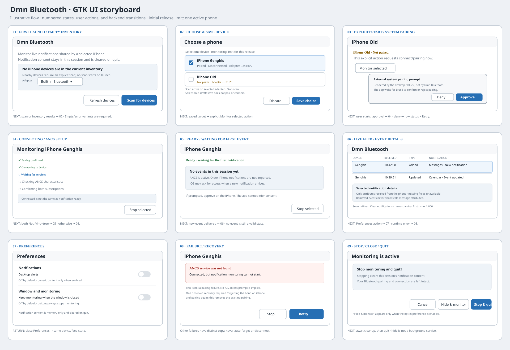

# Dmn Bluetooth GTK UI Storyboard

**Status:** Implementation-accurate overview of the current GTK 4/libadwaita
application. The frames show existing controls and behavior; generic desktop
alerts are available through the app menu. A general Preferences dialog and
close/hidden-window options are out of scope. The wide window opens maximized
with an even default split, and its divider proportion is restored on later
launches. The Devices sidebar is open by default, can be toggled by the single
sidebar button at the left edge of the Notifications header bar, and its
visibility, last viewed device, and All devices feed choice are restored on
later launches.

The application uses a resizable two-pane layout at wide window sizes, with a
left-edge Notifications header-bar control to hide or show the device sidebar.
Below the libadwaita breakpoint, it shows either the device list or
selected-device page; the same control navigates between them. The app menu
contains About, Desktop alerts, and Quit.

## Current screens and interaction contract

| Frame | Current UI state | User action and behavior |
| --- | --- | --- |
| 01 | **Inventory and empty detail.** The device pane contains adapter selection, Refresh/Scan/Stop scan, sortable Name/Status headings, and the device list. The detail pane prompts the user to choose a device. | Scanning, pairing, and connection are never initiated on launch. Monitoring resumes only for a saved device with previously enabled monitoring intent, after BlueZ confirms it is connected. |
| 02 | **Device selection.** Device rows show a checkbox, name, paired/connection status, and per-device Connect/Disconnect and Start/Stop monitoring buttons. A pending Connect is labeled **Disconnect** so it can be canceled; monitoring actions become available as soon as BlueZ confirms the connection. Save selection and Discard changes share a row with Selected only at wide sizes; those controls adapt to narrow widths. | Checkbox edits change the draft only. Selected only filters by the draft. Activating the device name opens its detail page; checking it does not navigate. |
| 03 | **Connected, not monitoring.** The selected-device page shows current device status and an empty session feed. After connection is confirmed, both **Disconnect** and **Start monitoring** are available. | Connect only connects unless saved monitoring intent is being restored; in that case monitoring starts as soon as BlueZ confirms Connected. A manual **Disconnect** clears that intent, stops monitoring first if active, and returns to a disconnected row with **Connect** enabled and **Start monitoring** disabled. Stop monitoring alone clears the intent but leaves the Bluetooth connection intact. |
| 04 | **Monitor setup and ready.** Setup progress and monitor state are shown in the device row and selected-device status. While setup is pending, the row offers **Stop monitoring** immediately; pressing it cancels startup and clears monitoring intent. Once ready, the feed explains that only new notifications received during this monitor session appear. | Monitor start/stop runs away from the GTK thread. The monitoring action follows saved intent rather than transient ANCS state; a Failed or Stopped monitor is cleaned up and retried while the device remains connected and intent remains enabled. Cancellation is cooperative between setup stages; an in-flight subscription is cleaned up when its bounded call returns, and its events are suppressed. A disconnect or disappearance observed during inventory polling stops an active monitor. Failed starts retry with jittered exponential backoff while that intent remains enabled. |
| 05 | **Live event feed.** A sortable-by-arrival table shows device, host receipt time, event kind/category, and available event text. Search, device, kind, and category filters compose; activating a row opens available details. Hovering notification text shows its full value wrapped to the feed pane. | New events appear first by callback arrival sequence, regardless of wall-clock changes. Selecting All devices shows that title without device-specific status; selecting a device restores its status and filters the feed. Clear filters restores the default view; Clear notifications removes only this process's in-memory feed. The 1,000-event limit is visible when older rows are evicted. Notification text remains selectable and copyable. |

### Narrow-window behavior

At narrow widths, the sidebar and detail page are navigated one at a time.
Device rows place their selection/name, status, and actions in separate
horizontal bands; scan and selection controls stack to avoid clipping. The
header-bar sidebar toggle returns to the device list or opens the detail page.
The same saved/draft selection and per-device lifecycle rules apply in either
layout.

### State ownership and lifecycle

- Stable adapter/device addresses identify saved devices. A saved device
  missing from BlueZ remains visible as unavailable.
- Selection, Bluetooth pairing, connection, and ANCS monitoring are separate
  states. Saving selection never pairs, connects, or starts a monitor.
- Connect requires a saved, paired device. Start monitoring additionally
  requires BlueZ-confirmed Connected state and does not perform discovery,
  pairing, or connection setup.
- Stop monitoring ends ANCS subscriptions but does not disconnect or unpair.
  Manual **Disconnect** clears monitoring intent, stops an active monitor
  first, then asks BlueZ to disconnect. An external connection loss stops the
  monitor while retaining saved intent for a later reconnection.
- An explicit monitoring choice persists across app exits. On relaunch, and
  after a device reconnects, the app resumes only those saved devices for
  which monitoring intent remains enabled; it never connects devices
  automatically.
- Failed monitor starts and unexpected ANCS Failed/Stopped events retain the
  saved intent and retry with jittered exponential backoff (about 5 seconds
  initially, capped at about 60 seconds). Stop monitoring clears the intent
  and ends automatic retries.
- Event data is held only in bounded process memory. Removed events do not
  display stale attributes. Closing the app waits for monitor/scan cleanup and
  then quits; it does not disconnect or unpair devices.
- The Selected only inventory filter restores its last on/off preference
  across launches.
- Device inventory polling does not recreate an unchanged event feed, which
  avoids clearing a text selection during routine refreshes.

## Out of scope

Preferences, close confirmation, and configurable keep-monitoring-on-close
behavior are not part of the active roadmap. The active roadmap is limited to
implemented optional desktop alerts (with desktop-session qualification
remaining) and release qualification. Generic desktop alerts are available
through the app-menu toggle, but are not depicted in these current-state
mockups; their presentation depends on the desktop notification service and
its user policy.

## GNOME HIG considerations

- The adaptive layout uses a breakpoint and a Back action instead of retaining
  a narrow split pane. List rows and controls stack at narrow widths.
- Buttons and checkboxes have descriptive accessible names; monitor and
  connection state is communicated as text, not color alone.
- Ongoing monitor status remains in the selected-device context rather than
  being represented by transient feedback.
- Notification preview text in the event table remains selectable, has a
  wrapped full-value hover tooltip, and offers a Copy-only context menu to
  avoid presenting irrelevant editing actions.

See the application's [implementation status and remaining release
qualification](dmn-bluetooth-gtk-app-spec.md) for build requirements,
GNOME/GTK references, and release gates.
