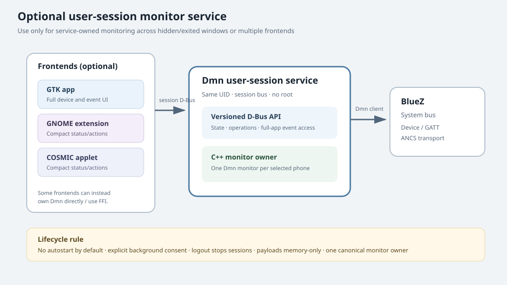

<!-- Copyright © 2025 - 2026 Chee Bin HOH. All rights reserved. -->

# Dmn Bluetooth User-Session D-Bus Service Specification

**Status:** Optional architecture proposal; no service is implemented.

This is a separately gated service that may own Dmn monitor sessions for a
standalone UI and shell-specific frontends. It is not required by the
recommended standalone GTK application. Use it only when monitoring must
continue after the main window closes/exits, or when multiple independent
frontends (for example, a COSMIC applet) need a single source of live state.

The service is a **user-session service**, not a system daemon: it runs as the
logged-in user on that user's session bus and talks to BlueZ through Dmn's
existing system-bus client. It does not run as root.

## 1. Goals and non-goals

### Goals

- Provide one process as the sole owner of one or more
  `Dmn_AncsBluezMonitor` instances.
- Expose versioned device inventory, monitoring state, bounded in-memory
  events, and explicit lifecycle actions to local frontends.
- Optionally stay alive when a window is hidden or closed, under an explicit
  user preference and clear app/service status.
- Isolate GNOME/COSMIC frontends from C++ ABI and prevent duplicate monitor
  instances for one selected device.
- Provide a testable D-Bus contract for same-user clients.

### Non-goals

- System-wide/root service, network API, cloud sync, or cross-user sharing.
- Persistent notification history, automatic pairing/reconnect, or automatic
  startup at login by default.
- Replacing BlueZ, changing ANCS protocol code, or making the notification
  center the event database.
- Keeping monitoring alive after logout, poweroff, or service termination.

## 2. When this service is and is not required

| Frontend/design | Service requirement |
| --- | --- |
| Standalone GTK app that owns monitoring and stops on process exit | Not required. Use Dmn C++ directly in the app process. |
| GTK app process remains alive with its window hidden | Not required. This is an in-process background mode; expose a clear user preference and process status. |
| GNOME extension that only launches/presents the app | Not required. The extension must not claim live status. |
| GNOME extension showing live state or issuing monitor actions while the app is not the service owner | Required unless a separate, deliberate C++ binding/shared-process design is adopted. Prefer D-Bus. |
| Native COSMIC app using a tested C++ FFI and owning monitor lifetime | Not required for the sole app frontend. |
| COSMIC applet sharing state with a native app, or monitoring after app exit | Required or replace with an explicitly tested shared-process architecture. |

The simplest first milestone remains direct in-process GTK. Do not build a
service merely to send `GNotification` alerts: the live GTK process can send
those while hidden.



### Suggested service source layout

```text
src/service/bluetooth/
  CMakeLists.txt
  main.cpp
  bluetooth-service.hpp/.cpp
  monitor-registry.hpp/.cpp
  event-buffer.hpp/.cpp
  dbus-contract.xml                 # source of truth for introspection/codegen
test/service/
  dmn-test-bluetooth-service-contract.cpp
  dmn-test-bluetooth-service-state.cpp
  dmn-test-bluetooth-service-private-bus.cpp
```

Keep the state machine and event buffer independent of GDBus so they can use
the existing GoogleTest convention without a D-Bus daemon. Put GDBus object
registration and serialization in a thin adapter. Add `src/service` and
`test/service` targets only behind a separate service option; do not make the
GTK app require them.

## 3. Process and lifecycle model

- Well-known name: choose a stable reverse-domain name, e.g.
  `org.cheebinhoh.DmnBluetooth1`; object root
  `/org/cheebinhoh/DmnBluetooth1`; interface version starts at `1`.
- One service instance per user login/session. No system-bus name and no
  privileged helper.
- Start on demand from an explicit **Start monitoring in background** action
  or a frontend request to start. Do not autostart or create a monitor merely
  because the service activates.
- A service method call that starts a monitor returns an operation ID; it
  does not synchronously block the D-Bus method handler. The Dmn monitor's
  current `start()` cannot be cancelled: a later Stop request marks
  stop-pending, waits for start to finish, then calls `stop()`. Report that
  truthfully to all clients.
- If background mode is enabled, closing the UI does not stop sessions.
  Provide **Stop all** and **Quit service** in the frontend. If disabled,
  frontend exit requests stop and service exits when idle.
- Logout/session-bus loss stops monitors, clears all event payloads, and
  exits. Process crash/termination must rely on Dmn destructors and BlueZ
  connection cleanup; bonds and links are not intentionally removed.
- The service reports actual owner/session/monitor state, not an optimistic
  “running” flag. A frontend must show `Unavailable` if the bus name is absent
  or API negotiation fails.
- Do not implement autonomous reconnect/repair initially. A failed device
  remains failed until a user-triggered **Retry**.
- One Dmn monitor instance per active phone. Concurrency remains a release
  gate; enforce a configured, documented active-device limit.

## 4. Proposed D-Bus interface

This is a versioned contract proposal; validate signatures against D-Bus and
GLib bindings before coding. Use finite method deadlines, bounded arrays and
strings, stable device identities, and typed errors. Never put transient
BlueZ object paths in saved frontend settings.

### Read-only methods and signals

- `GetVersion() → (u, s)` returns major protocol version and implementation
  version. Clients reject an unsupported major version.
- `GetSnapshot() → (a{sv}, aa{sv}, aa{sv})` returns service state,
  device inventory, and active monitor states. Use documented typed keys or
  dedicated D-Bus structs; do not rely on untyped ad hoc dictionaries without
  schema tests.
- `GetRecentEvents(u limit) → (aa{sv}, t oldestSequence, t newestSequence)`
  returns bounded in-memory events since this service process started, not
  phone history. Limit is capped by the service.
- `InventoryChanged(...)`, `MonitorChanged(...)`, `EventReceived(a{sv})`,
  `EventEvicted(t sequence)`, and `ServiceStateChanged(...)` provide live
  updates. Signals carry an increasing sequence number to detect gaps.
  `EventReceived` is payload-bearing and intended for full clients such as
  the desktop application; shell indicators must not subscribe to it. If a
  shell client needs a count, define a separate `EventCountChanged` signal
  whose schema contains only a bounded aggregate count and sequence, with no
  event attributes, device address, or title/message fields.

### Mutating methods

- `StartMonitor(s adapterAddress, s deviceAddress) → (s operationId)`.
- `StopMonitor(s deviceKey) → ()`.
- `RetryMonitor(s deviceKey) → (s operationId)`.
- `StopAll() → ()`.
- `ClearEvents() → ()`, clearing only this service's in-memory event list.
- `SetBackgroundMode(b enabled) → ()` only if the product elects to make
  background persistence a service setting; callers cannot infer it from
  window visibility.
- `QuitWhenIdle()` only for explicit shutdown; do not let a shell extension
  accidentally terminate an active shared service.

Return stable, documented errors for invalid argument, not found, not ready,
busy/limit reached, permission denied, backend failure, incompatible state,
and cleanup failure. Preserve Dmn's typed stage/error detail but redact
notification contents from errors.

### Event schema and retention

An event carries a service sequence, stable device key, event kind, host
receipt timestamp, optional category, optional app identifier/title/subtitle/
message/date attributes, and optional typed error. Payload fields are
sensitive and must be returned only to authorized same-user clients.

- Keep at most 1,000 event records in service memory for the service process
  lifetime; evict oldest first and emit `EventEvicted`.
- Do not write events to GSettings, files, journal, telemetry, or crash logs.
- Removed events carry no stale notification fields.
- A newly connected frontend gets only the service's recent in-memory buffer,
  not historical iPhone data. Label it as events received during this service
  run.
- `ClearEvents` is global for clients of this service. Frontends must explain
  that it clears the shared in-memory view, not the iPhone's notification
  center or currently active subscriptions.

## 5. Ownership, threading, and permissions

The service owns Dmn C++ objects and worker/controller lifetimes. D-Bus method
handlers must not block the main event loop on BlueZ or ANCS calls. Validate
arguments, create bounded operations, return operation IDs promptly, and emit
progress/state signals. Serialize start/stop for each device. Callback
handlers copy event data promptly and enqueue it to service-owned state.
Quiesce callbacks and workers before monitor destruction.

Use only the user's session bus. The service must not expose a system-bus
interface or accept remote/network connections. Reject calls from
unknown/unsupported interfaces and bound all client-controlled inputs. Verify
the D-Bus sender's user ID matches the service user before mutating state, but
document that same-user desktop processes generally share access to this
session service; this is not a security boundary against another process
running as the same user. Application IDs and extension UUIDs are not
credentials. Any same-user caller able to reach the service may be able to
read notification payloads; therefore payload access and retention must be
explicit in the threat model. Never include notification text in diagnostics.

If multiple clients exist, make service state canonical. A disconnected
frontend must not implicitly stop a monitor, except when the selected policy
explicitly says monitoring belongs to that frontend and no background
preference is active. Make this policy visible in UX and test it.

## 6. Frontend contract

- GTK, GNOME extension, or COSMIC frontend negotiates the protocol on connect.
- Subscribe to signals, then fetch a snapshot and sequence range; reconcile
  duplicate/out-of-order snapshot/signal events by sequence.
- Detect signal gaps and refresh the snapshot; never silently assume current
  state.
- If service disappears or the protocol is unsupported, display unavailable,
  disable state-changing controls, and keep app launch/help available.
- Frontends do not parse ANCS protocol details, own duplicate monitors, or
  infer `Ready` from BlueZ `Connected`.
- GNOME Shell extensions and COSMIC applets must consume only status and
  payload-free aggregate signals. They must not call `GetRecentEvents` or
  subscribe to `EventReceived`; automated contract tests assert this
  data-minimization boundary.
- The service API is not a mechanism for inserting content into GNOME/COSMIC
  notification centers. Optional desktop alerts remain frontend/service
  policy and are best-effort.

## 7. Test-driven implementation plan

1. **Contract first.**
   - Test: assert method/signal names, signatures, enum values, major-version
     rejection, error names, string/array/event size bounds, and unknown
     future fields. No BlueZ calls.
   - Implement: `dbus-contract.xml` (or another single machine-readable
     source) and generated/checked bindings.
   - Verify: parse/generate the interface in CI (`gdbus-codegen` if selected)
     and compare runtime introspection to the contract.
2. **Service skeleton.**
   - Test: session-bus name ownership, duplicate instance, bus disconnect,
     wrong API version, clean exit, and no system-bus registration.
   - Implement: process main loop, session bus object registration, lifecycle
     state only.
   - Verify: run a CTest under a private session bus and use `gdbus introspect`
     to inspect the object; assert there is no monitor factory invocation on
     service activation.
3. **Pure state model.**
   - Test: device states, per-device serialization, configured concurrency
     limit, sequence, arrival ordering, 1,000-event eviction, Clear semantics,
     stop-pending during synchronous start, and payload-free diagnostics.
   - Implement: injected fake monitor registry and bounded event buffer.
   - Verify: run GoogleTest service-state binary without a bus or BlueZ.
4. **D-Bus fake-monitor path.**
   - Test: snapshot/signal race, sequence gaps, malformed requests, finite
     deadlines, start/stop/retry, simultaneous calls, owner loss, and
     structured failures.
   - Implement: async method dispatch that returns operation IDs and
     serializes worker operations per device.
   - Verify: private-session-bus test with a fake monitor; confirm the bus
     main loop responds while a fake start is delayed.
5. **Dmn adapter and callback ownership.**
   - Test: progress, typed errors, cleanup failure, stop waiting for start,
     callback quiescence, destructor order, and no payload in logs.
   - Implement: real `Dmn_AncsBluezMonitor` factory adapter; preserve the
     documented limitation that stop cannot cancel setup.
   - Verify: repository fake-BlueZ/GATT private-bus integration. Enable
     multiple monitor instances only after tests demonstrate one phone's
     failure does not affect another.
6. **Lifecycle policy.**
   - Test: no auto-start on activation/login; user-selected background
     transition; disconnecting UI; Stop all; Quit service; idle exit; logout;
     and process termination.
   - Implement: one explicit background/foreground ownership policy and
     state signal.
   - Verify: private-bus lifecycle tests assert exactly when sessions stop
     and the event buffer clears; test bus-loss behavior.
7. **Frontend clients.**
   - Test: version negotiation, missed-signal recovery, stale status,
     same-user denial, no service, and permission/error states in GTK/GJS/Rust
     client tests against one fake service.
   - Implement: thin client adapters; no monitor lifecycle logic in frontends.
   - Verify: run each frontend contract suite and assert it sees identical
     state/sequence from the service.
8. **Packaging and security.**
   - Test: install/update/remove, user service activation policy, no root,
     no system-bus name, bounds, same-user threat model, and journal/crash
     scrubbing.
   - Implement: optional service package and user-session activation only if
     product requirements call for it; autostart remains disabled by default.
   - Verify: install in a disposable user profile, inspect bus names/system
     service files, and scan test logs for synthetic payload canaries.
9. **Opt-in hardware.**
   - Test: retain full private-bus coverage and record a hardware checklist.
   - Implement: no new protocol behavior beyond demonstrated needs.
   - Verify: qualify start/stop/disconnect/multiple devices/logout on recorded
     BlueZ, adapter, phone, iOS, and desktop versions. Private-bus success is
     not iPhone interoperability proof.

## 8. Acceptance criteria

- **SERVICE-AC-01:** No service is started or monitoring performed without
  an explicit user start; autostart is off by default.
- **SERVICE-AC-02:** Applets and frontends read a consistent snapshot and
  recover from signals missed during connection.
- **SERVICE-AC-03:** No persistent notification payload storage or payload logging exists.
- **SERVICE-AC-04:** Service failure/unavailability is visible and does not
  produce false Ready state.
- **SERVICE-AC-05:** Start/stop operations are asynchronous to D-Bus callers,
  bounded, serialized per device, and safely cleaned up.
- **SERVICE-AC-06:** Service remains optional to the core Dmn library and default CMake build.
- **SERVICE-AC-07:** Shell clients receive only payload-free status/count
  signals and never request event history.

## 9. Research references

- [D-Bus specification](https://dbus.freedesktop.org/doc/dbus-specification.html):
  session-bus names, object/interface model, and messages.
- GLib [GDBus](https://docs.gtk.org/gio/class.DBusConnection.html):
  connection and object integration reference for a future implementation.
- [GDBus code generator](https://docs.gtk.org/gio/gdbus-codegen.html):
  optional generation of typed client/server glue from introspection XML.
- [XDG Base Directory Specification](https://specifications.freedesktop.org/basedir/latest/)
  and systemd user-service documentation should be consulted if a user
  service unit or persisted preferences are introduced; no autostart is
  implied by this spec.
- Related: [GUI overview](dmn-bluetooth-gui-spec.md), [GTK app](dmn-bluetooth-gtk-app-spec.md),
  [GNOME extension](dmn-bluetooth-gnome-extension-spec.md), and
  [COSMIC app/applet](dmn-bluetooth-cosmic-spec.md).
